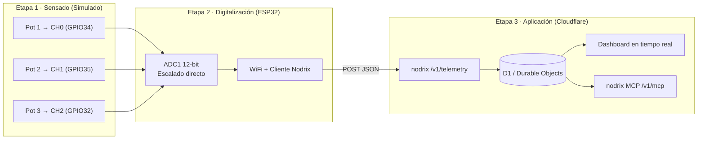

# Sensorica Blueprint

Arquitectura integral **sensado → digitalización → aplicación**, construida y simulada de punta a punta (Wokwi + PlatformIO) conectada en tiempo real a una plataforma IoT en Cloudflare (**Nodrix**).

---

## Arquitectura



---

## Estructura del Repositorio

```
sensorica_blueprint/
├── firmware/                  # Proyecto PlatformIO (Firmware ESP32)
│   ├── platformio.ini         # Configuración del entorno esp32dev y librerías
│   ├── wokwi.toml             # Configuración de simulación Wokwi
│   ├── diagram.json           # Circuito: ESP32 + 3 potenciómetros (ADC1)
│   ├── include/
│   │   ├── config.h           # Pines ADC1, periodos y rangos físicos
│   │   └── secrets.h.example  # Plantilla de credenciales WiFi y Nodrix
│   └── src/                   # Código fuente C++ (Etapas 1 y 2)
├── dashboard/                 # Definición y exportación de widgets / dashboard
├── docs/                      # Documentación de diseño, plan y pruebas
│   └── plan.md                # Plan de implementación detallado
└── README.md
```

---

## Mapeo de Magnitudes Físicas

| Canal | Pin (ADC1) | Variable | Unidad | Rango Físico |
|---|---|---|---|---|
| CH0 | GPIO34 | `temperatura` | °C | 0 – 100 |
| CH1 | GPIO35 | `humedad` | % HR | 0 – 100 |
| CH2 | GPIO32 | `iluminacion` | lx | 0 – 1000 |

> **Nota:** Se utiliza exclusivamente **ADC1** (GPIO 32, 34, 35) ya que el ADC2 queda inhabilitado al operar la radio WiFi del ESP32.

---

## Documentación y Guías

- [Plan de implementación](file:///home/leonard0/eCodes/sensorica_blueprint/docs/plan.md): Hitos, fases y arquitectura.
- [Acondicionamiento y Sensores Reales](file:///home/leonard0/eCodes/sensorica_blueprint/docs/acondicionamiento.md): Mapeo virtual, cálculo de funciones de transferencia y diseño de etapas analógicas (filtros RC, clamping, amplificadores de instrumentación y transimpedancia).

---

## Simulación en Wokwi (Etapas 1 y 2)

1. Abre el archivo [`firmware/diagram.json`](file:///home/leonard0/eCodes/sensorica_blueprint/firmware/diagram.json) en el IDE.
2. Inicia la simulación presionando el botón de **Play** de la extensión de Wokwi (o comando `Wokwi: Start Simulator`).
3. El firmware cargará automáticamente el binario compilado en `.pio/build/esp32dev/firmware.bin`.
4. El ESP32 se conecta a la red `Wokwi-GUEST` y a la instancia de Nodrix en Cloudflare.
5. Cada 10 segundos, el firmware lee los 3 potenciómetros y envía el lote de métricas (`temperatura`, `humedad`, `iluminacion`) hacia `POST /v1/telemetry`, confirmando con respuesta HTTP `204`.