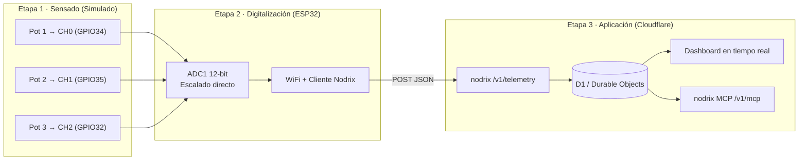

# Sensorica Blueprint

Arquitectura integral **sensado → digitalización → aplicación**, construida y simulada de punta a punta (Wokwi + PlatformIO) conectada en tiempo real a una plataforma IoT en Cloudflare (**Nodrix**).

---

## Arquitectura



---

## Estructura del Repositorio

```
sensorica_blueprint/
├── firmware/                  # Proyecto PlatformIO (Firmware ESP32)
│   ├── platformio.ini         # Configuración del entorno esp32dev y librerías
│   ├── wokwi.toml             # Configuración de simulación Wokwi
│   ├── diagram.json           # Circuito: ESP32 + 3 potenciómetros (ADC1)
│   ├── include/
│   │   ├── config.h           # Pines ADC1, periodos y rangos físicos
│   │   └── secrets.h.example  # Plantilla de credenciales WiFi y Nodrix
│   └── src/                   # Código fuente C++ (Etapas 1 y 2)
├── dashboard/                 # Definición y exportación de widgets / dashboard
├── docs/                      # Documentación de diseño, plan y pruebas
│   └── plan.md                # Plan de implementación detallado
└── README.md
```

---

## Mapeo de Magnitudes Físicas

| Canal | Pin (ADC1) | Variable | Unidad | Rango Físico |
|---|---|---|---|---|
| CH0 | GPIO34 | `temperatura` | °C | 0 – 100 |
| CH1 | GPIO35 | `humedad` | % HR | 0 – 100 |
| CH2 | GPIO32 | `iluminacion` | lx | 0 – 1000 |

> **Nota:** Se utiliza exclusivamente **ADC1** (GPIO 32, 34, 35) ya que el ADC2 queda inhabilitado al operar la radio WiFi del ESP32.

---

## Documentación y Guías

- [Plan de implementación](docs/plan.md): Hitos, fases y arquitectura.
- [Acondicionamiento y Sensores Reales](docs/acondicionamiento.md): Mapeo virtual, cálculo de funciones de transferencia y diseño de etapas analógicas (filtros RC, clamping, amplificadores de instrumentación y transimpedancia).

---

## Cómo Reproducir el Proyecto desde GitHub

### Requisitos Previos

- **Git** y **PlatformIO** (extensión **PlatformIO IDE** o CLI `pio`).
- Extensión **Wokwi Simulator** instalada en el IDE y con licencia activa (`F1` → `Wokwi: Request a New License`).
- Una instancia de **[Nodrix](https://nodrix.live)** desplegada en **Cloudflare Workers** (el plan gratuito es suficiente) con un proyecto creado y su respectivo **Project Token**.

### 1. Clonar el repositorio

```bash
git clone https://github.com/oscar88leonardo/sensorica_blueprint.git
cd sensorica_blueprint
```

### 2. Configurar las credenciales (`secrets.h`)

El archivo `secrets.h` está excluido de Git por seguridad. Créalo a partir de la plantilla incluida:

```bash
cp firmware/include/secrets.h.example firmware/include/secrets.h
```

Edita `firmware/include/secrets.h` con los datos de tu entorno:

```cpp
#define WIFI_SSID    "Wokwi-GUEST"                       // Red virtual de Wokwi (o tu WiFi real en ESP32 físico)
#define WIFI_PASS    ""                                  // Sin contraseña en Wokwi-GUEST
#define NODRIX_HOST  "tu-instancia.workers.dev"          // Host de tu Worker en Cloudflare (sin https:// ni /)
#define NODRIX_TOKEN "pega_aqui_tu_project_token"        // Token del proyecto generado en Nodrix

// (Opcional - Solo producción en hardware físico)
// #define NODRIX_CA_CERT "-----BEGIN CERTIFICATE-----\n...\n-----END CERTIFICATE-----\n"
```

> **Nota sobre Seguridad TLS (`NODRIX_CA_CERT` vs `setInsecure`):**
> - **En simulación (Wokwi) y prototipado:** Si `NODRIX_CA_CERT` no está definido, el firmware invoca `Nodrix.setInsecure()`. El tráfico sigue viajando **cifrado mediante TLS**, pero se omite la verificación de la cadena X.509 de la Autoridad Certificadora (CA). Esto evita fallos por falta de sincronización de reloj NTP al arranque (`1970-01-01`), reduce la carga de cómputo en el simulador y tolera la rotación automática de certificados de borde en Cloudflare.
> - **En producción (ESP32 físico):** Para proteger el `NODRIX_TOKEN` frente a ataques *Man-in-the-Middle (MITM)* en redes WiFi reales, define `NODRIX_CA_CERT` en `secrets.h` con el certificado PEM de la Root CA que firma tu dominio en Cloudflare (por ejemplo, `ISRG Root X1` o `GTS Root R1`, consultable con `openssl s_client -showcerts -connect <tu-instancia>.workers.dev:443 </dev/null`). Al detectarlo, [`telemetry_init()`](firmware/src/telemetry.cpp) activará automáticamente `Nodrix.setCACert(NODRIX_CA_CERT)`.

*(Opcional)* En [`firmware/include/config.h`](firmware/include/config.h) puedes ajustar `TELEMETRY_INTERVAL_MS` según tu caso de uso (por ejemplo `1000` ms para pruebas cortas interactivas o `10000` ms para operación continua cuidando la cuota gratuita de Cloudflare).

### 3. Compilar el firmware

Dado que la carpeta `.pio/` no se versiona en el repositorio, es indispensable compilar antes de iniciar el simulador para generar `.pio/build/esp32dev/firmware.bin` y `firmware.elf` (referenciados en [`firmware/wokwi.toml`](firmware/wokwi.toml)):

```bash
pio run -d firmware
```

*(También puedes usar el botón **PlatformIO: Build** desde el IDE abriendo el directorio `firmware`).*

### 4. Iniciar la simulación en Wokwi

1. Abre [`firmware/diagram.json`](firmware/diagram.json) en el IDE.
2. Presiona el botón **Play** de Wokwi (o ejecuta `F1` → `Wokwi: Start Simulator`).
3. Comprueba en el Monitor Serie la conexión a `Wokwi-GUEST` y las confirmaciones `HTTP 204` (`TLS Keep-Alive reutilizado`) al mover los 3 potenciómetros.

> **Recomendación de rendimiento:** En equipos con 8 GB de RAM o menos, se recomienda mantener el navegador cerrado en el PC (dejando visible la pestaña de Wokwi en primer plano) y visualizar el dashboard en tiempo real desde otro dispositivo (celular o tablet) para evitar *throttling* del simulador y saturación de memoria.

### 5. Configurar o visualizar el Dashboard en Nodrix

- Con el primer envío exitoso desde Wokwi, las variables `temperatura`, `humedad` e `iluminacion` se registran automáticamente en tu proyecto de Nodrix.
- Puedes armar los widgets desde la interfaz web de Nodrix tomando como referencia [`dashboard/README.md`](dashboard/README.md) y la definición exportada en [`dashboard/monitoreo_sensores.json`](dashboard/monitoreo_sensores.json) (o automatizarlo conectando el servidor **Nodrix MCP** en `/v1/mcp`).

---

## Simulación en Wokwi (Etapas 1 y 2)

1. Abre el archivo [`firmware/diagram.json`](firmware/diagram.json) en el IDE.
2. Inicia la simulación presionando el botón de **Play** de la extensión de Wokwi (o comando `Wokwi: Start Simulator`).
3. El firmware cargará automáticamente el binario compilado en `.pio/build/esp32dev/firmware.bin`.
4. El ESP32 se conecta a la red `Wokwi-GUEST` y a la instancia de Nodrix en Cloudflare mediante una sesión `HTTPS Keep-Alive` persistente.
5. En cada ciclo (`TELEMETRY_INTERVAL_MS`), el firmware lee los 3 potenciómetros y envía el lote de métricas (`temperatura`, `humedad`, `iluminacion`) hacia `POST /v1/telemetry`, confirmando con respuesta HTTP `204`.

---

## Dashboard en Tiempo Real (Etapa 3)

El dashboard fue generado a través del servidor Nodrix MCP:
- **Nombre:** Monitoreo de Sensores
- **ID:** `dsh_9oOUFs5IEnsH`
- **Widgets configurados:**
  - 3 × Tarjetas de valor numérico con unidades (`°C`, `% HR`, `lx`).
  - 3 × Diales analógicos (*gauges*) con rangos nominales.
  - 1 × Gráfico temporal de 3 series con ventana de 1 hora y zoom interactivo.
- Exportación local: [`dashboard/monitoreo_sensores.json`](dashboard/monitoreo_sensores.json).

- **Acceso Publico:** https://nodrixapp.oscar88leonardo-351.workers.dev/share/zbEBe-cFM4Vb

