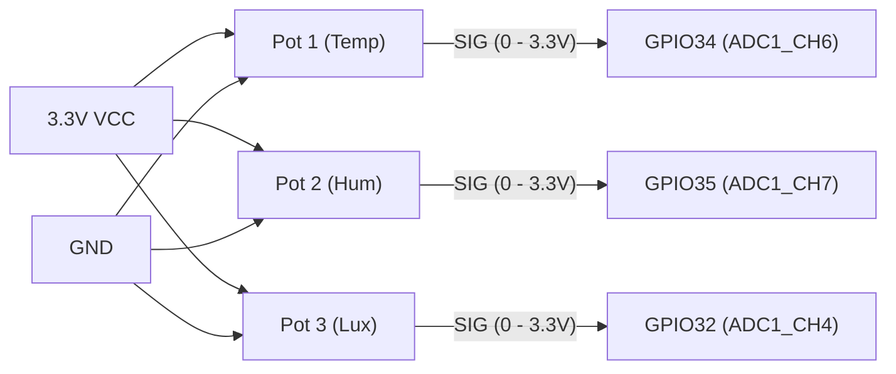
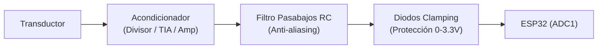

# Acondicionamiento de Señal y Sensores

Este documento describe la arquitectura de sensado del proyecto **Sensorica Blueprint**, detallando el modelo de simulación virtual utilizado en la **Etapa 1** y las recomendaciones de diseño analógico para la transición a **sensores físicos reales**.

---

## 1. Modelo de Sensado Virtual (Simulación en Wokwi)

En la fase de simulación, las tres magnitudes físicas se emulan utilizando **potenciómetros rotativos** conectados al convertidor analógico-digital (ADC) del ESP32:

### Tabla de Asignación y Escalado

| Magnitud | Pin ESP32 | Canal ADC | Variable Nodrix | Rango Crudo ADC | Rango Físico | Función de Transferencia |
|---|---|---|---|---|---|---|
| **Temperatura** | `GPIO34` | ADC1_CH6 | `temperatura` | 0 – 4095 | 0.0 – 100.0 °C | $T = \text{ADC} \times \frac{100.0}{4095}$ |
| **Humedad** | `GPIO35` | ADC1_CH7 | `humedad` | 0 – 4095 | 0.0 – 100.0 % HR | $H = \text{ADC} \times \frac{100.0}{4095}$ |
| **Iluminación** | `GPIO32` | ADC1_CH4 | `iluminacion` | 0 – 4095 | 0.0 – 1000.0 lx | $E = \text{ADC} \times \frac{1000.0}{4095}$ |

> [!IMPORTANT]
> **Uso exclusivo de ADC1:**  
> En el ESP32, el bloque **ADC2** comparte circuitería y registros internos con el módem WiFi. Por tanto, cuando la radio WiFi se inicializa (como ocurrirá en la Etapa 2), cualquier intento de lectura en ADC2 fallará o producirá valores erráticos. Por esta razón, todos los canales de entrada se ubicaron estrictamente en **ADC1** (`GPIO32`, `GPIO34`, `GPIO35`). Además, `GPIO34` y `GPIO35` son pines de *solo entrada* (GPI), lo que los hace ideales para entradas analógicas al no contar con resistencias pull-up/pull-down internas activables.

---

## 2. Características del ADC del ESP32

El convertidor SAR del ESP32 presenta particularidades críticas a considerar:

1. **Resolución:** Configurada a **12 bits** (rango entero de 0 a 4095).
2. **Atenuación:** Configurada a **11 dB** (`ADC_11db`), lo que permite que el rango de entrada alcance el voltaje completo de alimentación de $3.3\,\text{V}$ (rango nominal típicamente entre $0.15\,\text{V}$ y $3.1\,\text{V}$).
3. **No-linealidad:** El ADC del ESP32 tiene zonas muertas no-lineales en los extremos inferiores ($< 0.1\,\text{V}$) y superiores ($> 3.1\,\text{V}$). En la simulación con potenciómetro el escalado lineal simple cubre $0$ a $4095$; en hardware real, se recomienda calibración eFuse o utilizar la API `esp_adc_cal` para convertir lecturas en milivoltios reales.
4. **Impedancia de entrada:** El circuito interno de muestreo y retención (Sample & Hold) requiere que la impedancia de salida de la fuente de señal sea $\le 10\,\text{k}\Omega$ para que el condensador interno cargue completamente durante el tiempo de muestreo.

---

## 3. Guía de Acondicionamiento para Sensores Reales

Cuando se sustituyan los potenciómetros por transductores físicos reales, se debe incorporar una etapa de acondicionamiento de señal para cada magnitud:

### 3.1 Sensor de Temperatura (Termistor NTC o Analógico TMP36 / LM35)
- **Caso A (Termistor NTC 10 kΩ):** Requiere un divisor resistivo con una resistencia fija de $10\,\text{k}\Omega$ al 1% de precisión. Dado que la respuesta es no lineal, el cálculo en firmware debe emplear la ecuación de **Steinhart-Hart** o el parámetro $\beta$.
- **Caso B (TMP36 / LM35):** Salida de voltaje lineal proporcional a la temperatura ($10\,\text{mV}/^\circ\text{C}$).
  - El TMP36 opera directamente a $3.3\,\text{V}$ con un rango de $0.1\,\text{V}$ ($-40\,^\circ\text{C}$) a $1.75\,\text{V}$ ($125\,^\circ\text{C}$), encajando en la zona lineal del ADC.
  - Se recomienda un amplificador no inversor si se desea expandir el rango dinámico a toda la escala del ADC.

### 3.2 Sensor de Iluminación (Fotodiodo o Fotorresistencia LDR)
- **Fotorresistencia (LDR):** Divisor resistivo con resistencia calibrada (ej. $10\,\text{k}\Omega$). Su respuesta es fuertemente logarítmica respecto a los lux ($\text{lx} = A \cdot R^{-\gamma}$).
- **Fotodiodo de precisión:** Genera una fotocorriente proporcional a la iluminancia. Requiere un **Amplificador de Transimpedancia (TIA)** basado en un amplificador operacional de bajo offset (ej. OPA340, MCP6001 con riel a riel) con un condensador de compensación en paralelo a la resistencia de ganancia para evitar oscilaciones.

### 3.3 Sensor de Humedad Relativa
- La mayoría de sensores modernos de humedad son digitales (I2C como SHT31, AHT20 o DHT22).
- Si se utiliza un sensor analógico resistivo/capacitivo (ej. HS1101 con temporizador 555 o convertidor frecuencia-voltaje), la salida de voltaje acondicionada debe oscilar entre $0\,\text{V}$ y $3.0\,\text{V}$.

---

## 4. Circuito de Protección y Filtrado Recomendado

Para cada canal analógico antes de entrar al pin del ESP32:

1. **Filtro Pasabajos RC (Anti-aliasing y Rechazo de Ruido):**
   - $R = 1\,\text{k}\Omega$, $C = 100\,\text{nF}$.
   - Frecuencia de corte: $f_c = \frac{1}{2\pi RC} \approx 1.59\,\text{kHz}$.
   - Elimina ruido de alta frecuencia del entorno y conmutaciones digitales del ESP32.
2. **Protección contra Sobretensión (Clamping):**
   - Par de diodos Schottky (ej. BAT54S) conectados entre el nodo de entrada, GND y el riel de $3.3\,\text{V}$.
   - Evita que picos inductivos o voltajes superiores a $3.3\,\text{V} + 0.3\,\text{V}$ dañen la compuerta interna del microcontrolador.
3. **Buffer (Seguidor de Tensión):**
   - Si la impedancia de la etapa sensora supera los $10\,\text{k}\Omega$, interponer un amplificador operacional en configuración seguidor unitario (buffer) con alimentación simple de $3.3\,\text{V}$ y salida *rail-to-rail*.
