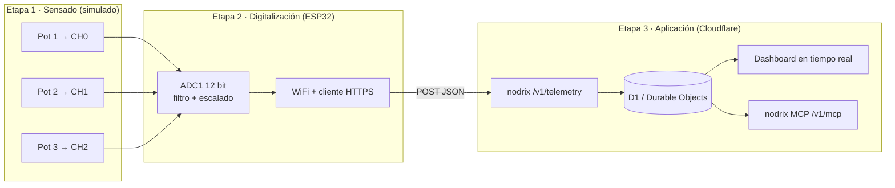

# Plan: Dashboard básico para monitoreo de sensores

Arquitectura **sensado → digitalización → aplicación**, construida y simulada de punta a punta
(Wokwi) antes de pasar a hardware real.

## Decisiones tomadas

| Tema | Decisión |
|---|---|
| Backend | nodrix se **despliega en la Etapa 0** en tu cuenta de Cloudflare (**Opción A: one-click**) |
| Magnitudes | **Temperatura** (0–100 °C), **humedad** (0–100 % HR), **iluminación** (0–1000 lx) |
| Acondicionamiento | **Simple**: escalado directo del valor leído por ADC a los rangos físicos (sin filtros ni atenuación extra) |
| Cliente en el ESP32 | **Librería Nodrix** (Arduino) |
| Dashboard | Lo **crea el agente con el nodrix MCP** |
| Periodo de publicación | **10 s** |



---

## Etapa 0 · Preparación del entorno

### 0.1 Herramientas de firmware

| Tarea | Detalle | Quién |
|---|---|---|
| PlatformIO MCP | `npm install -g platformio-mcp` y registrarlo en `~/.gemini/config/mcp_config.json` (también disponible como CLI `pio-agent`) | Agente |
| Wokwi | Verificar licencia activa de la extensión (gratuita, renovación mensual) | Tú |
| Repo | Estructura base + `.gitignore` (`secrets.h`, `.pio/`, `.pio-mcp-workspace/`) | Agente |

### 0.2 Despliegue de nodrix en Cloudflare

| # | Paso | Quién |
|---|---|---|
| 1 | Tener una cuenta de Cloudflare (el plan gratuito de Workers es suficiente) y cuenta en GitHub | Tú |
| 2 | Desplegar nodrix mediante el botón **Deploy** de [nodrix.live](https://nodrix.live) (one‑click: autoriza a Cloudflare para clonar el repo en tu GitHub y desplegar Workers + Durable Objects + D1 + R2) | Tú |
| 3 | Primera visita a `https://<instancia>.workers.dev` → *Create owner account* | Tú |
| 4 | Crear el proyecto `sensorica-blueprint` y generar un **token de proyecto** (lo usará el ESP32) | Tú |
| 5 | Prueba de humo: `POST /v1/telemetry` con `curl` y lectura con `GET /v1/projects/<proyecto>/state` | Agente |

> [!NOTE]
> Los pasos 1–4 requieren autenticarte en el navegador, por eso los haces tú. Los pasos exactos se verificarán contra la documentación vigente de nodrix al ejecutar.

### 0.3 Habilitar el nodrix MCP

| # | Paso | Quién |
|---|---|---|
| 1 | En *Settings → More* activar `mcp_enabled` y **`mcp_write_enabled`** (necesario para que el agente cree el dashboard) | Tú (solo el owner puede) |
| 2 | En *Settings → Tokens* generar un **token admin limitado al proyecto** `sensorica-blueprint` | Tú |
| 3 | Registrar el servidor `https://<instancia>.workers.dev/v1/mcp` (transporte HTTP, cabecera `Authorization: Bearer <token>`) en `mcp_config.json`, fuera del repo | Agente |
| 4 | Verificar conexión con `list_projects` | Agente |

### Estructura propuesta del repositorio

```
sensorica_blueprint/
├── firmware/                  # Proyecto PlatformIO (Etapas 1 y 2)
│   ├── platformio.ini
│   ├── wokwi.toml             # apunta a .pio/build/esp32dev/firmware.{bin,elf}
│   ├── diagram.json           # ESP32 + 3 potenciómetros
│   ├── include/
│   │   ├── config.h           # pines, periodos, rangos de escalado
│   │   └── secrets.h.example  # WIFI_SSID, WIFI_PASS, NODRIX_HOST, NODRIX_TOKEN
│   └── src/
│       ├── main.cpp
│       ├── sensors.{h,cpp}    # lectura ADC y escalado directo a unidades
│       └── telemetry.{h,cpp}  # WiFi + envío a nodrix
├── dashboard/                 # Etapa 3: definición/export del dashboard y notas
├── docs/                      # arquitectura, decisiones, resultados de pruebas
└── README.md
```

---

## Etapa 1 · Sensor y acondicionamiento (simulado con potenciómetros)

**Objetivo:** 3 señales analógicas de 0–3.3 V en entradas ADC del ESP32, en Wokwi.

- **Circuito (`diagram.json`)**: 3 × `wokwi-potentiometer` (VCC = 3V3, GND, SIG → ADC).
- **Pines: solo ADC1** → `GPIO34`, `GPIO35`, `GPIO32`.
  > [!IMPORTANT]
  > ADC2 no se puede usar mientras el WiFi está activo en el ESP32. Todos los canales deben ir en ADC1.
- **Modelo de "sensor virtual"** (en `config.h`): cada canal se mapea a una magnitud física para
  que el dashboard muestre unidades reales:
  | Canal | Pin | Variable | Unidad | Rango (ADC: 0 → 4095) |
  |---|---|---|---|---|
  | CH0 | GPIO34 | `temperatura` | °C | 0 – 100 |
  | CH1 | GPIO35 | `humedad` | % HR | 0 – 100 |
  | CH2 | GPIO32 | `iluminacion` | lx | 0 – 1000 |

  Los nombres de variable van sin tildes ni espacios porque son las claves que llegan a nodrix.
- **Acondicionamiento digital simplificado**:
  - Lectura directa con `analogRead(pin)` (resolución nativa de 12 bits: 0 a 4095).
  - Escalado lineal directo del valor medido al rango físico de cada variable:
    - `temperatura = map(adc0, 0, 4095, 0, 100)` (o flotante equivalente: `adc0 * (100.0 / 4095.0)`)
    - `humedad = adc1 * (100.0 / 4095.0)`
    - `iluminacion = adc2 * (1000.0 / 4095.0)`
  - Sin atenuaciones adicionales, sin calibración eFuse ni sobremuestreo/filtros por software.
- **Documentar** en `docs/` cómo sería el acondicionamiento con sensores reales (divisor de tensión,
  amplificador operacional, filtro RC antialiasing, protección), para cuando se sustituyan los potenciómetros.

**Criterio de aceptación:** al mover cada potenciómetro en Wokwi, el monitor serie muestra
el valor crudo del ADC (0–4095) y el valor escalado en sus unidades físicas en el rango establecido.

---

## Etapa 2 · Adquisición en el ESP32 y transmisión WiFi

**Objetivo:** muestrear los 3 canales periódicamente y publicarlos en nodrix por HTTPS.

- **`platformio.ini`**: `board = esp32dev`, `framework = arduino`, `monitor_speed = 115200`,
  `lib_deps` = `decoded-cipher/Nodrix` (librería oficial en el registro de PlatformIO) + `bblanchon/ArduinoJson`.
- **Arquitectura del firmware** (no bloqueante, basada en `millis()`):
  - `Nodrix.run()` en cada iteración de `loop()`.
  - Tarea de **muestreo y publicación**: cada **10 s** → lectura escalada directa de los 3 canales y envío con
    `Nodrix.send("temperatura", t)`, `Nodrix.send("humedad", h)`, `Nodrix.send("iluminacion", lx)`
    (la librería las agrupa en una sola petición).
  - **Conectividad**: `Nodrix.begin(WIFI_SSID, WIFI_PASS, HOST, TOKEN)` levanta WiFi y la conexión;
    se registra el estado por serie. Si el WebSocket por defecto da problemas en Wokwi, se cambia a
    `Nodrix.beginHTTP()` (peticiones HTTPS periódicas).
- **Protocolo subyacente** (nodrix): `POST https://<host>/v1/telemetry`, `Authorization: Bearer <token_proyecto>`,
  cuerpo `{"metrics":{"temperatura":23.4,"humedad":61,"iluminacion":450}}`. Las variables se crean
  solas la primera vez que llegan.
- **Ampliación futura**: la misma librería permite recibir órdenes con `NODRIX_WRITE("variable")` (p. ej. un actuador).
- **WiFi en Wokwi**: SSID `Wokwi-GUEST`, sin contraseña (tiene salida a Internet).
- **TLS**: primero modo inseguro (cifrado sin verificar) para validar; luego fijar root CA con
  `Nodrix.setCACert()`.
- **Secretos**: `secrets.h` ignorado por git; solo se versiona `secrets.h.example`.
- **Uso del PlatformIO MCP**: `agent_validate_project`, `build` + `agent_build_diagnose`,
  `agent_safe_pin_audit` (valida GPIO34/35/32 como entradas ADC1), y más adelante
  `agent_flash_monitor_verify` con hardware real.

**Criterio de aceptación:** en la simulación Wokwi el log serie muestra `WiFi OK` y respuestas
HTTP 2xx de nodrix; las 3 variables aparecen en el proyecto nodrix.

---

## Etapa 3 · Aplicación: dashboard en nodrix (Cloudflare)

**Objetivo:** visualizar en tiempo real los 3 canales. El dashboard lo crea el agente vía nodrix MCP.

- **Prerrequisito**: las 3 variables ya existen en nodrix (llegaron desde Wokwi en la Etapa 2).
- **Dashboard "Monitoreo de sensores"**:
  | Widget | Variable(s) | Configuración |
  |---|---|---|
  | gauge | `temperatura` | 0–100 °C |
  | gauge | `humedad` | 0–100 % HR |
  | gauge | `iluminacion` | 0–1000 lx |
  | value ×3 | cada variable | lectura numérica + unidad |
  | chart | las 3 variables | serie temporal (ventana p. ej. 1 h) |
- **Flujo con el MCP**:
  1. `list_variables` → confirmar claves y unidades.
  2. `list_widget_types` → obtener los tipos y la forma de sus props.
  3. Crear el dashboard y colocar los widgets (herramientas de escritura).
  4. `get_dashboard` / `list_widgets` → verificar la disposición y guardar la definición en `dashboard/`.
- **Verificación de datos**: `get_state` y `get_series` para comprobar que los valores coinciden
  con la posición de los potenciómetros en Wokwi.
- **Cierre de seguridad**: con el dashboard creado, desactivar `mcp_write_enabled` (el MCP queda en solo lectura).
- **Opcional**: enlace público de solo lectura; automatización de alerta por umbral (Telegram/email) como mejora futura.

**Criterio de aceptación:** mover un potenciómetro en Wokwi se refleja en el dashboard en ≤ 1 periodo de publicación.

---

## Hitos

| # | Hito | Entregable |
|---|---|---|
| H0 | Entorno listo | MCPs conectados, nodrix desplegado (Opción A), repo estructurado |
| H1 | Señales digitalizadas | Firmware lee ADC y escala 3 canales en Wokwi |
| H2 | Telemetría en la nube | Datos llegan a nodrix desde Wokwi cada 10 s |
| H3 | Dashboard operativo | Dashboard creado vía MCP en tiempo real + verificación |
| H4 | Documentación | README, diagrama, decisiones y pruebas en `docs/` |

## Riesgos y consideraciones

- **Plan gratuito de Cloudflare**: límites diarios de peticiones a Workers y de escrituras en D1. Con 3 variables cada 10 s ≈ 8.640 envíos/día; mantenerse en este intervalo para no exceder cuotas gratuitas.
- **Seguridad**: token de proyecto (dispositivo) separado del token admin (MCP); ningún token se versiona; MCP en solo lectura una vez creado el dashboard.
- **Herramientas de escritura del MCP**: nodrix no expone herramientas de borrado, así que un error del agente se corrige editando, no se pierde información.
- **Wokwi + Internet**: el gateway público de Wokwi puede añadir latencia y cortar conexiones largas (relevante para el WebSocket; alternativa `beginHTTP()`).
